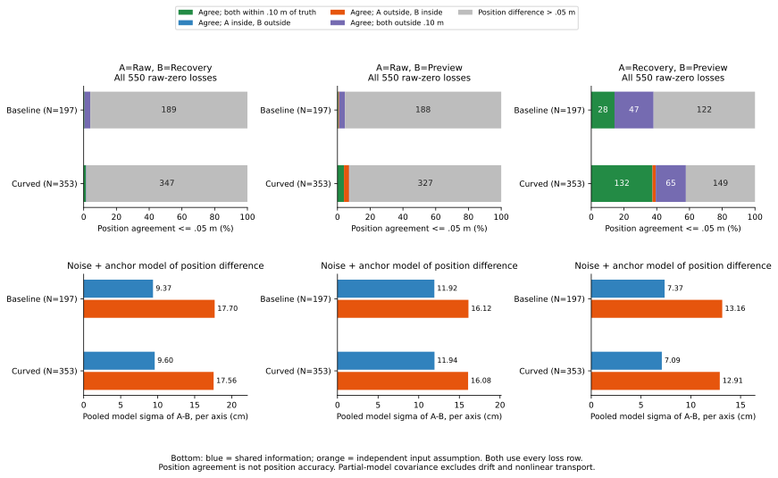

# Shared information and pairwise position agreement

In the fixed 550-loss population, recovery and preview are numerically
identical within 1e-8 m in 168 records. In 102 of those records, both are more
than .10 m from truth. They share the same observations and correction anchor:
their common error cancels in the difference without disappearing from either
input. Position agreement is therefore a different diagnostic from accuracy.

The [protocol](protocol.md) was frozen as 7f66e0b before results. Inputs are the
tracked [position-error components](../speed-probe-error-components/report.md)
and preceding loss memberships. Every audited state is retained: 6,610 states,
19,830 inputs, 26,990 per-anchor weights and 19,830 pairs (6,610 of each pairing).
The complete 648-case accounting, 368 timeouts and 2,583 opportunities remain
unchanged. No raw replay, geometry query or controller rollout was introduced.

## Reconstructing shared information

All recorded input groups have contiguous sample ranges, one anchor ID per
group and uniform observation sigma within an input. Their weights reproduce
the component vectors and source noise/anchor marginal variances within
1e-12 m^2. Raw and recovery each use the current anchor only; preview uses that
anchor or three distinct epoch anchors. Older anchor variances need not be
guessed: every pairing contains raw or recovery, so only the current anchor
can be shared. Its variance is known from the raw input's marginal.

Noise covariance uses actual observation steps, weights, sigmas and the
cohort's recorded AR correlation. It includes identical observations and
temporal covariance between different observations. A sorted-step recurrence
matches a full double-sum test. Shared-anchor covariance is the product of
the current-anchor weights times its variance.

The full three-input covariance matrix is positive semidefinite within the
fixed numerical tolerance at all 6,610 states (minimum normalized determinant
-4.44e-16 from rounding). Difference variance is `VA+VB-2*Cov(A,B)`; assuming
independent inputs instead uses `VA+VB`. This partial per-axis model covers
noise and anchor offsets, excluding drift and nonlinear motion/heading
transport. It is not a calibrated posterior or a physical safety guarantee.

## Agreement in the complete 550-loss population

Position agreement uses a closed .05 m threshold in this table. Accuracy is
each input's closed .10 m position disk relative to the same preceding
physical row, without a heading test. A/B follow the table's pairing order.
No accuracy comparison is within 1e-8 m of its boundary.

| Arm / N | A / B | Agree: both inside | A inside / B outside | A outside / B inside | Agree: both outside | Disagree |
|---|---|---:|---:|---:|---:|---:|
| Baseline / 197 | Raw / Recovery | 1 | 0 | 0 | 7 | 189 |
| Baseline / 197 | Raw / Preview | 1 | 0 | 1 | 7 | 188 |
| Baseline / 197 | Recovery / Preview | 28 | 0 | 0 | 47 | 122 |
| Curved / 353 | Raw / Recovery | 5 | 0 | 0 | 1 | 347 |
| Curved / 353 | Raw / Preview | 14 | 0 | 11 | 1 | 327 |
| Curved / 353 | Recovery / Preview | 132 | 0 | 7 | 65 | 149 |

Recovery/preview agree within .05 m in 279/550 records; 112 have both positions
outside the truth disk. Of the 168 numerically identical records, baseline
has 55 (39 both outside) and curved 113 (63 both outside). Every one of these
168 uses the shared-single-anchor preview fallback and the same sample
weights. Their partial-model difference variance is zero, while each input's
marginal uncertainty remains positive.

The other 382 loss records use a three-epoch preview: baseline 142 and curved
240. At .05 m, 10 have both inputs outside the truth disk while agreeing;
none are numerically identical. These are repeated, selected records, not
independent accuracy trials. All .02 and .10 m sensitivity rows are also
retained, without choosing a threshold from outcomes.

Keep the fixed command-only subset of 509 separately. Its combined recovery/
preview counts at .05 m are 133 both inside, 0 A-only inside, 7 B-only inside,
108 both outside and 261 disagree. It includes 160 numerically identical
records. Each input/pair view shares the same original action, so counts from
different pairings or the 550/509 populations must not be added as attempts.

## Difference uncertainty versus independence

For all 550 loss records, pool each model's variances over states and then
take a square root. These are model sigmas per axis, in cm, rather than
observed RMS errors or confidence bounds.

| Arm | Pairing | Shared-information difference sigma | Independent-input sigma |
|---|---|---:|---:|
| Baseline | Raw / Recovery | 9.369 | 17.701 |
| Baseline | Raw / Preview | 11.924 | 16.120 |
| Baseline | Recovery / Preview | 7.371 | 13.160 |
| Curved | Raw / Recovery | 9.599 | 17.558 |
| Curved | Raw / Preview | 11.941 | 16.077 |
| Curved | Recovery / Preview | 7.090 | 12.913 |

Restricting recovery/preview to the 168 shared-fallback loss records gives
zero difference sigma in both arms, versus 15.443/14.520 cm under independence.
This says that the two inputs contain the same modeled error, not that either
position is known precisely.

Revisit transition 106204, event 1626, new-white curved random seed 275, maze
JPS, t=160.56 s. Pair 10554 joins recovery pose 14070 and motion-filter preview
14071. Both use the same 25 observations and anchor 8000 with weight 1. Their
position difference is zero, but each position error is 17.5153 cm. Each
noise-plus-anchor marginal variance is .0104 m^2 and covariance is also
.0104 m^2. The difference variance is zero; ignoring covariance yields sigma
14.4222 cm. This is the earlier residual preview-loss conflict, with unchanged
geometry and control.

For contrast, prior example poses 1742/1743 form pair 1308 at t=161.38 s:
recovery uses anchor 8000 with weight 1; three-epoch preview uses anchors
7500/7750/8000 with weights 1/3. They share no observation samples and have
zero white-noise covariance, but still share .0033333 m^2 of anchor covariance.
Their difference sigma is 8.4853 cm, versus 11.7757 cm under independence;
their observed position separation is 17.1421 cm. Neither calculation is a
new controller or a calibrated hypothesis test.

## Broader population and reproduction

Across all audited states, recovery/preview have 3,030 shared-single-anchor
records and 3,580 three-epoch records. Only 3,000 are numerically identical:
sharing an anchor alone does not imply identical observation windows. All
6,610-state summaries remain separate from the loss-selected population.
The older [information-floor study](../admission-information-floors/report.md)
assumed ideal independent new batches; the present analysis measures the
information actually shared by recorded inputs.

Run the [README commands](../../README.md#shared-information-and-position-agreement)
with new directories. All seven CSVs and [sources.json](sources.json) repeat
byte for byte. Plot CSV/SVG/PNG/provenance also repeat exactly; the figure was
visually checked and PNG remains in scratch. The Python suite passes
**353 tests**, including 13 new tests for sparse AR covariance, shared offsets,
variance guards, three-input PSD, component closure and agreement accounting.

[inputs.csv](inputs.csv) and [anchor-weights.csv](anchor-weights.csv) retain
input identities, reconstructed marginals and anchor weights. Historical
anchor-specific variances not needed by a pair remain blank rather than
being invented. [pairs.csv](pairs.csv) contains all 19,830 covariance/difference
records, including all four observed component differences.
[loss-links.csv](loss-links.csv) retains one row per original 550 transitions
with three pair IDs and the 509-subset flag. [summary.csv](summary.csv) has
4,860 rows including empty event kinds and anchor modes. [Accounting](accounting.csv)
and [events](events.csv) exactly match the previous files. The figure's
[252 numeric rows](shared-information-comparisons.csv) and
[provenance](shared-information-comparisons-sources.json) retain all bins.
Original observation/physics checks are inherited and held goals remain
**140 -> 140**; no release or physical safety improvement is claimed.
