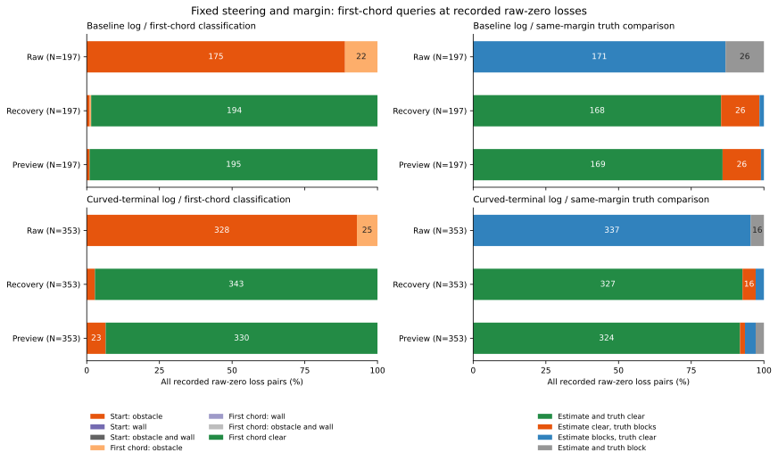

# 速度プローブが0になる開始点と最初の区間

速度上限0で復帰条件が途切れた550対の事後地点では、503地点（91.5%）が開始位置ですでに障害物との余裕不足、47地点が最初の0.05mの弦で余裕不足でした。壁による不成立は0です。同じ推定位置と余裕を使うこのプローブでは、開始点での不成立を操舵だけの変更で解消できません。

同じ操舵・余裕で復帰入力へ幾何の入力を替えると537地点、予測入力へ替えると525地点で最初の弦が通りました。ただし、そのうち42・32地点では、記録された真位置に同じ余裕を当てると弦が通りません。これらは固定した地図照会の結果で、改善した復帰数や走行成功数ではありません。

## 固定した対象と比較方法

[固定手順](protocol.md)を先に記録し、[前回の境界解析](../correction-gate-boundaries/report.md)の全648ケースの会計、時間切れ368ケース、全2,583機会を引き継ぎました。既知・追加seed、独立・相関ノイズ、両記録と欠測・精密補正の分類を保持しています。

幾何の対象は、前回から固定した全6,610地点と6,187隣接対です。片側が合同条件成立の対で、成立獲得・成立維持・成立喪失・復帰後の経路退出を含みます。100記録ケース・171機会に属し、基準epochが2,922地点、旋回終端curvedが3,688地点です。残る機会は監査地点数0として明示しました。合同条件が一度もそろわない機会を、今回の幾何で判定したことにはしていません。

各地点で生観測raw・復帰recovery・予測preview・記録の真位置truthを使い、それぞれの位置と向きだけを替えて同じ地図を照会しました。予定操舵と`speed_margin`は記録値で固定しています。真位置の時刻も前回と同じ、推定・判定行の積分前の物理状態です。

コントローラーや予定操舵、指令、タイマーを入力に合わせて再計算していません。真位置にも不確かさを含む元の速度余裕を使い、物理的な接触半径へ縮めていません。これは真位置からの観察された運動ではなく、同じ条件で行う幾何の基準照会です。

## 開始点と最初の弦の分割

開始点と最初の0.05mの弦で、障害物距離と壁までの距離を別々に計算しました。弦は記録の操舵・入力の向きで進めた円弧の両端を結ぶもので、元の速度プローブと同じ対象です。距離が速度余裕以下なら不成立で、障害物・壁とも等号を許しません。

開始点が不成立ならその分類を優先します。開始点が通る場合だけ、最初の弦による不成立に分けます。元の2mプローブが0を返すのはこの2段階で、最初の弦が通れば元の自由距離は少なくとも0.05mです。先の全経路まで通ることを意味しません。

次は、前回から固定した`raw_zero_loss`、すなわち後続の合同条件喪失で速度上限が0となった全550対です。事後地点も550個で、基準38機会・19記録ケース、旋回56機会・27記録ケースで反復しています。

| 生観測による不成立の場所 | 基準の地点 | 旋回の地点 | 合計 |
|---|---:|---:|---:|
| 開始点・障害物 | 175 | 328 | 503 |
| 最初の弦・障害物 | 22 | 25 | 47 |
| 開始点または弦・壁 | 0 | 0 | 0 |
| 合計 | 197 | 353 | 550 |

開始点で障害物との距離が余裕以下なら、どの向き・操舵の経路にもその開始点が含まれます。503地点での不成立はこの意味で操舵だけでは変わりません。推定位置が真位置と一致する、あるいは実際の車体が接触しているという主張ではありません。

同じ550地点の真位置の照会では、508地点で最初の弦が通り、42地点で不成立でした。不成立42地点のうち28地点は開始点、14地点は最初の弦で、すべて障害物によるものです。

## 入力を替えた幾何と真位置との一致

同じ550対の事後地点について、最初の弦と真位置の判定を比較しました。各行の分母は基準197・旋回353で共通です。3入力の行は同じ記録動作を見たもので、独立した試行や追加の復帰として合算していません。

| 記録・入力 | 弦が通る | 入力・真位置とも通る | 入力は通るが真位置は不成立 | 入力は不成立だが真位置は通る | 両方不成立 |
|---|---:|---:|---:|---:|---:|
| 基準・生観測 | 0 | 0 | 0 | 171 | 26 |
| 基準・復帰 | 194 | 168 | 26 | 3 | 0 |
| 基準・予測 | 195 | 169 | 26 | 2 | 0 |
| 旋回・生観測 | 0 | 0 | 0 | 337 | 16 |
| 旋回・復帰 | 343 | 327 | 16 | 10 | 0 |
| 旋回・予測 | 330 | 324 | 6 | 13 | 10 |

復帰入力で新しく弦が通る537地点のうち、真位置でも通るのは495、同じ余裕で不成立なのは42です。予測入力では525地点のうち493が真位置でも通り、32が不成立でした。反対に、生観測では不成立でも真位置では通る508地点のうち、復帰入力13・予測入力15地点は不成立のままでした。

速度指令だけが不成立だった`command_only_zero_loss`全509対では、復帰・予測入力とも509地点すべてで弦が通りました。しかし、そのうち32地点（基準26・旋回6）は真位置では不成立です。これらの32地点を「解消できた停止」として数えていません。



図は各記録の全197・353対を分母にし、3入力の事後地点を示します。ラベルは件数で、4%未満は省略しています。図の数値には、通常受信・欠測・精密補正の分類とその合計を保持し、0を含む264区間を[数値表](probe-start-comparisons.csv)に保存しました。欠測・精密補正のこの部分集合は0対です。

## 同じ入力を続けたときの変化

生観測は550対すべてで、直前の弦が通る状態から不成立へ変わりました。復帰入力は537対で通る状態を維持し、13対で不成立へ変化しました。予測入力は525対で通る状態を維持し、16対で不成立へ変化、9対で不成立のままでした。

これらは記録にある推定入力の幾何の変化です。予測入力が通り続けたことと、元の生観測を使う速度指令が正だったことは同じではありません。今回は入力を替えた後の自由距離全体や速度上限、新しい停止・終端予測、合同要件の連続成立時間を計算していません。

## 前回の中断例と不一致の具体例

前回からのevent_id=400、known-white・epoch・blackout・seed269・迷路・A*の150.56秒では、生観測の開始点の障害物余裕は+0.008182mで通りますが、最初の弦では−0.013915mとなりました。この中断は開始点によるものではありません。同じ弦の障害物余裕は復帰入力+0.156039m、予測入力+0.063923m、真位置+0.010751mで、いずれも正でした。

event_id=1638、new-white・curved・random・seed276・密集地図・A*の150.26秒と151.04秒は、生観測の開始点の障害物余裕がそれぞれ−0.049406m・−0.018920mでした。この2地点は開始点での不成立です。真位置の最初の弦の余裕は+0.063406m・+0.047849m、復帰・予測入力でも正でした。

一方、不一致群の最小transition_id=5706（event_id=87、known-white・curved・blackout・seed271・密集地図・A*、161.38秒）では次のようになりました。速度指令のみが不成立だった地点です。同じ余裕0.910442712m、同じ操舵0.215825668radを使っています。

| 入力 | 開始点の障害物余裕m | 最初の弦の障害物余裕m | 判定 |
|---|---:|---:|---|
| 生観測 | −0.043241 | −0.043241 | 開始点で不成立 |
| 復帰 | +0.219023 | +0.219023 | 通る |
| 予測 | +0.078102 | +0.078102 | 通る |
| 真位置 | −0.011108 | −0.011108 | 開始点で不成立 |

この例では入力を替えた幾何の許可が、真位置に同じ余裕を適用した結果と食い違います。真位置での距離不足は元の余裕に対するもので、実際に衝突したことを示すものではありません。

## 全監査地点と群別の範囲

550対以外も含めた全6,610監査地点の分類は次のとおりでした。各入力は同じ地点集合を使います。壁による不成立はこの全26,440照会でも0でした。

| 記録・入力 | 地点 | 開始点で不成立 | 最初の弦で不成立 | 最初の弦が通る |
|---|---:|---:|---:|---:|
| 基準・生観測 | 2,922 | 225 | 29 | 2,668 |
| 基準・復帰 | 2,922 | 5 | 6 | 2,911 |
| 基準・予測 | 2,922 | 47 | 5 | 2,870 |
| 基準・真位置 | 2,922 | 467 | 161 | 2,294 |
| 旋回・生観測 | 3,688 | 422 | 30 | 3,236 |
| 旋回・復帰 | 3,688 | 18 | 0 | 3,670 |
| 旋回・予測 | 3,688 | 72 | 0 | 3,616 |
| 旋回・真位置 | 3,688 | 395 | 12 | 3,281 |

真位置に対する不一致も全入力・全地点で集計表に残しました。対象は合同条件成立に接する地点と、最終的な時間切れに条件付けられています。誤判定率の校正や、一般の走行への包含率としては使っていません。

既知独立・既知相関・追加独立・追加相関の順の速度0の対数は、基準57・0・119・21、旋回82・2・256・13でした。すべてを保持し、入力の比較で群や地点を選び直していません。真位置・入力・時間が重なる反復記録であり、550回の独立な走行試験ではありません。

## 検証と再実行

解析コードは`b3ca876`、図と手順は`baa8df2`です。追跡済みの全171,082状態・168,708対の表を読み、固定された6,610地点・6,187詳細対とのID・時刻・入力の対応を確認しました。全6,610地点の生観測の開始点／弦の分類は、前回独立に監査した全速度プローブの自由距離の正・0と一致しました。

全26,440姿勢で地図全体の点障害物と壁を走査し、開始点・弦それぞれの最近傍障害物を保存しました。元と同じ微小曲率の直線分岐を使い、それ以外はsincによる安定した円弧端点を使っています。境界2e−8m以内の姿勢は0でした。保存CSVでも入力・余裕・操舵、独立な端点式、最近傍の証拠点、距離、分類、真位置との比較、対と集計、固定550・509対、指紋とリンクを照合しました。

Python全297テストが成功しました。追加15件で開始点の障害物・壁の等号と同時不成立、開始点が通るのに弦で遮られる例、最初の弦と全経路の違い、向き・操舵だけでは変わらない開始点、独立な数値積分との端点一致、微小曲率、異なる最近傍点と同距離の選択、境界印と厳密な条件の区別、4つの真位置との関係、入力だけ許可となる不一致、固定した部分集合、入力別の分母と空の群を確認しました。BlackとPython構文検査も成功しました。

```bash
python3 experiments/pose_observation_loss/analyze_speed_probe_starts.py \
  --output /tmp/speed-probe-starts
python3 experiments/pose_observation_loss/plot_speed_probe_starts.py \
  --results /tmp/speed-probe-starts --output /tmp/speed-probe-starts-figure
python3 -m unittest discover -s experiments/pose_observation_loss -p 'test_*.py'
```

出力先は新しいディレクトリを使います。解析は標準ライブラリー、図はMatplotlibを使い、追跡済みの表と地図だけで再実行できます。生軌跡を再び用意する必要はありません。7つのCSVと`sources.json`は2回の解析でバイト単位に一致しました。図の数値・SVG・PNG・指紋も一致し、表示を確認しました。

[accounting.csv](accounting.csv)は全648ケース、[events.csv](events.csv)は全2,583機会と監査地点・対数、[poses.csv](poses.csv)は4入力の26,440照会、[pairs.csv](pairs.csv)は3入力の18,561対、[start-blocks.csv](start-blocks.csv)は元の550対を1対1行で保存します。[state-summary.csv](state-summary.csv)は240集計、[pair-summary.csv](pair-summary.csv)は入力・群・元の条件変化・部分集合別の6,480集計です。

`state_id`・`transition_id`・`event_id`は[前回の表](../correction-gate-boundaries/report.md)と共通です。`pose_id`で照会と対を結び、最近傍障害物IDは[地図](../../inputs/obstacles.csv)の各scenario内で出現順に数えた1始まりの番号です。同距離なら先の点を保存しています。[sources.json](sources.json)と[図の指紋](probe-start-comparisons-sources.json)に入力・コード・手順・地図・図の指紋があります。

新しい全速度上限、解除条件やタイマー、走行・物理・保持結果は生成していません。観測復元と物理検証は元の監査を引き継ぎ、元の制御・余裕・保持結果140→140は更新していません。
