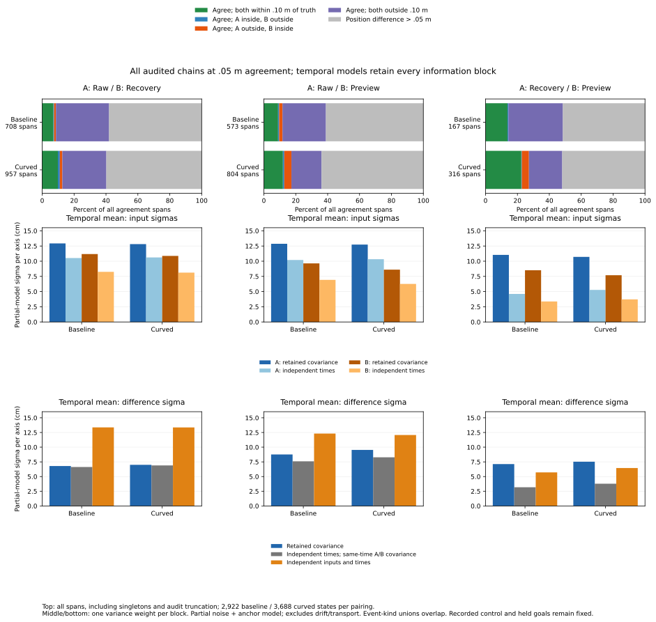

# Agreement persistence and temporal shared information

The earlier 102 loss records where recovery and preview are numerically
identical but both more than .10 m from truth belong to 52 audited agreement
spans, across 15 recorded cases and 20 original loss opportunities. Repeating
agreement within a span does not supply independent position confirmations:
the same observations are reused and the common correction offset remains.

The [protocol](protocol.md) was frozen as f684b17 and the analyzer/tests as
b5cbb43 before new outcomes. Inputs are tracked artifacts from the
[shared-information study](../speed-probe-shared-information/report.md), the
original explicit chains and recorded position-error components. All 648 case
records, 368 timeouts, 2,583 opportunities, 423 chains and 6,610 states remain.
All three pairings and four rules yield 79,320 state/pair/rule memberships,
partitioned into 13,281 spans. Every span already has constant anchor-ID/weight
signatures, so there are also 13,281 information blocks and no extra signature
splits. This is a measured outcome, not an assumption in the implementation.

## Complete agreement-span partition

The following counts use the frozen closed .05 m position-agreement rule.
Accuracy remains each input's closed .10 m truth-position disk, without
heading. Every pairing covers 2,922 baseline and 3,688 curved states. Spans
count maximal runs of one of the five categories, retaining singletons.

| Arm | A / B | Both inside | A inside / B outside | A outside / B inside | Both outside | Disagree | All spans |
|---|---|---:|---:|---:|---:|---:|---:|
| Baseline | Raw / Recovery | 50 | 3 | 8 | 236 | 411 | 708 |
| Baseline | Raw / Preview | 51 | 4 | 12 | 156 | 350 | 573 |
| Baseline | Recovery / Preview | 23 | 1 | 0 | 57 | 86 | 167 |
| Curved | Raw / Recovery | 94 | 12 | 15 | 264 | 572 | 957 |
| Curved | Raw / Preview | 96 | 7 | 36 | 152 | 513 | 804 |
| Curved | Recovery / Preview | 71 | 1 | 14 | 66 | 164 | 316 |

For recovery/preview spans that agree while both are outside the truth disk:

| Arm | Spans | States | Median elapsed (s) | Maximum (s) | Singletons | Left audit truncation | Right audit truncation | Either |
|---|---:|---:|---:|---:|---:|---:|---:|---:|
| Baseline | 57 | 1,580 | .44 | 1.34 | 3 | 52 | 52 | 54 |
| Curved | 66 | 1,363 | .12 | 1.34 | 3 | 61 | 58 | 62 |

Elapsed support is the last minus first decision time, `(states-1)*.02 s`.
Singleton support is zero. Most spans in this table reach an audit boundary;
the observations do not establish their full onset or resolution. Explicit
missing edges split chains even if selected timestamps happen to be adjacent.
Span lengths and counts are diagnostics of selected audited histories, not
independent trials or a census of complete physical error episodes.

At reconstruction tolerance <=1e-8 m, the full recovery/preview population
has 49 baseline and 59 curved both-outside spans, covering 1,466 and 1,251
states. The .02, .05 and .10 m rules are all retained in the CSVs; no rule or
minimum duration was selected from results. Whole-span event-kind unions can
overlap and include source opportunities outside the loss-selected rows.

## Original losses mapped to spans

Every original 550 transition IDs maps to all three pairings and four rules:
6,600 [loss memberships](loss-memberships.csv), preserving the 509 command-only
flags. The following reconstruction-tolerance counts use original loss event
IDs for opportunities, rather than the whole-span event union. Blocks equal
spans for these data. Recorded case identities include cohort and arm.

| Arm | Loss population | Loss rows | Unique spans / blocks | Recorded cases | Loss opportunities |
|---|---|---:|---:|---:|---:|
| Baseline | Numerically identical | 55 | 26 | 9 | 11 |
| Curved | Numerically identical | 113 | 53 | 6 | 13 |
| Combined | Numerically identical | 168 | 79 | 15 | 24 |
| Baseline | Identical, both outside | 39 | 19 | 9 | 10 |
| Curved | Identical, both outside | 63 | 33 | 6 | 10 |
| Combined | Identical, both outside | 102 | 52 | 15 | 20 |

These remain repeated records of the original actions. Neither 102 rows nor
52 spans nor 15 recorded case identities imply that many independent physical
attempts. Other loss rows, disagreement bins and all 509-subset memberships
remain in the exported data.

## Variance of a temporal mean

For each input in each block, reconstruct its per-decision observation-step
coefficients from group weights, sample counts and sigma. Average coefficients
over the block, including repeated uses of each original observation. Apply
the AR kernel `rho^abs(i-j)` to these averaged sparse coefficients. This keeps
overlapping windows and cross-time correlation between different samples.

Stable anchor signatures preserve the same anchor random variable in every
decision: its marginal variance and the cross-input anchor covariance remain
unchanged in the mean. No older anchor-specific variances are invented.
The independent-time comparison instead uses `sum_t(V_t)/n^2`. For a mean
difference, compare both retaining same-time input covariance while discarding
cross-time covariance, and discarding both input and time covariance.

Pool variances with one weight per information block, then take a square
root. The following partial-model sigmas are per axis, in **cm**, for all
.05 m blocks, including all five categories and singletons. Because blocks
depend on pairing/category, an input's pooled sigma can differ by pairing.

| Arm | A / B | Blocks | A retained | A independent times | B retained | B independent times |
|---|---|---:|---:|---:|---:|---:|
| Baseline | Raw / Recovery | 708 | 12.924 | 10.520 | 11.171 | 8.251 |
| Baseline | Raw / Preview | 573 | 12.866 | 10.194 | 9.637 | 6.924 |
| Baseline | Recovery / Preview | 167 | 11.038 | 4.608 | 8.507 | 3.372 |
| Curved | Raw / Recovery | 957 | 12.811 | 10.617 | 10.871 | 8.118 |
| Curved | Raw / Preview | 804 | 12.730 | 10.330 | 8.605 | 6.258 |
| Curved | Recovery / Preview | 316 | 10.710 | 5.278 | 7.689 | 3.719 |

For the mean difference, the same block weights give:

| Arm | A / B | Retained covariance | Independent times, same-time A/B covariance | Independent inputs and times |
|---|---|---:|---:|---:|
| Baseline | Raw / Recovery | 6.796 | 6.627 | 13.370 |
| Baseline | Raw / Preview | 8.764 | 7.591 | 12.323 |
| Baseline | Recovery / Preview | 7.124 | 3.178 | 5.710 |
| Curved | Raw / Recovery | 7.000 | 6.896 | 13.364 |
| Curved | Raw / Preview | 9.537 | 8.278 | 12.077 |
| Curved | Recovery / Preview | 7.526 | 3.781 | 6.457 |

Discarding input covariance and discarding time covariance have different
effects; the fully independent calculation is not uniformly an upper or lower
comparison for the difference. Common errors can cancel between inputs while
remaining correlated across time. These partial models include noise and
anchor offsets, exclude drift/nonlinear transport, and are not calibrated
posterior bounds or release criteria.

## Revisiting the residual preview-loss example

Transition 106204, event 1626, new-white curved random seed 275, maze JPS,
t=160.56 s, remains pair 10554 (poses 14070/14071). It lies in original chain
290, index 17. Reconstruction span/block 8573 and .05 m span/block 8575 cover
all 21 decisions of that chain, t=160.22--160.62 s, or .40 s. Both boundaries
are audit-truncated and every decision is numerically identical/both outside.

Each input uses anchor 8000 with weight 1. Across the block it makes 434
observation uses of just 32 unique original observation steps. The retained
mean noise variance is .000397454 m^2; anchor variance remains .010000000 m^2.
The partial input-mean sigma is **10.1968 cm**, versus **2.2374 cm** under
independent times. Both mean-error vectors are
(-.0395528512, -.1943524640) m, with norm **19.8336 cm**.

The input mean difference and its modeled variance are both zero, while
the individual input errors and uncertainties remain nonzero. Mean-error
vectors are offline arithmetic relative to each decision's known truth;
they do not create a new position estimate for a moving robot or relabel any
point. The source geometry, action, pause and outcome are unchanged.

## Reproduction and saved artifacts

Run the [README commands](../../README.md#agreement-persistence-and-temporal-shared-information)
using new output directories. All **nine CSVs plus provenance** repeat byte
for byte. Plot CSV/SVG/PNG/provenance repeat exactly; the final figure was
visually inspected and PNG remains in scratch. The Python suite passes
**367 tests**, including 14 new tests for repeated/overlapping observations,
white and correlated disjoint samples, persistent anchors, identical biased
inputs, signature splits, explicit missing edges, singleton support, mean
vector closure, variance guards and complete summary groups.

A separate saved-data calculation checked all 79,320 category memberships
and maximal chain partitions, all 13,281 blocks against 9,704 distinct dense
AR-kernel calculations, all 6,600 loss joins, all 14,400 summary rows and all
432 numerical figure rows. Script, protocol, input and helper hashes match.

[Spans](spans.csv) retain boundaries, event unions and endpoint identities;
[blocks](blocks.csv) retain signatures, observation reuse, mean errors and
all variance comparisons. [Span summaries](span-summary.csv) and
[block summaries](block-summary.csv) include empty cohorts/event kinds and
anchor modes. [Accounting](accounting.csv), [events](events.csv),
[chains](chains.csv) and [members](members.csv) are unchanged copies of their
pinned sources. [Analysis provenance](sources.json),
[figure data](temporal-information-comparisons.csv) and
[figure provenance](temporal-information-comparisons-sources.json) are tracked.
Original observation/physics validation is inherited. Held goals remain
**140 -> 140**.
