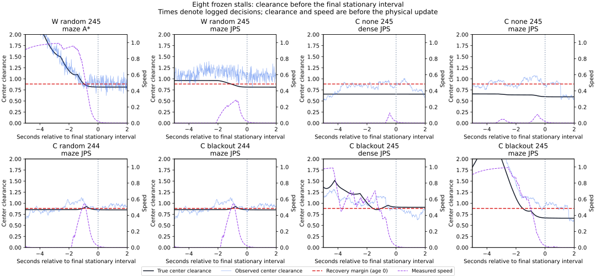

# 復帰余裕を失う前の制動と観測の診断

既知の停止8例のうち7例では、車体中心の距離が最小の復帰余裕0.88284を割ったまま終了しました。その最後の境界通過時点では、7例すべてで、真姿勢から即座に既存の強い制動を続けても、同じ操舵を保つ予測ではこの距離を維持できませんでした。6例は実際にもその時点で制動中でした。停止後の解除だけでなく、停止前の速度と観測に対して距離余裕を確認する必要があります。

今回は保存済みの同じ8例の事後解析です。制御・距離余裕・ノイズを変更せず、新しい走行や保持成功率の比較は行っていません。

## 対象と時刻の定義

[前進弧の診断](../recovery-arcs/report.md)と同じ `joint` 群の8軌跡を使い、その解析が保存した生軌跡のハッシュとの一致を要求しました。全例180秒で時間切れです。全区間について、真の車体中心と観測された中心の点障害物・地図境界からの距離を再構成しています。

比較する0.88284は、sigma=0.1・観測年齢0の復帰余裕 `0.6 + 2√2×0.1` です。中心距離がこれを超えることは、始点を含む復帰経路の必要条件です。前方0.6の復帰直線、現在の観測年齢、ガード、連続確認を含む十分条件ではありません。物理半径0.5での接触条件とも異なります。

「最後の境界通過」は、真の中心距離が0.88284より大きい状態から以下の状態へ移り、そのまま終了まで戻らない区間の始まりです。一時的に割ってから戻った通過は別に数えます。「最後の静止区間」は、最後に速度0.02を超えた状態の次から180秒までです。完全な速度0を意味しません。「最後の制動開始」は、その静止への移行を含む連続した強い制動指令の開始であり、走行中の最初の制動ではありません。

| ノイズ・欠落 | seed・地図・計画器 | 最後の境界通過 | 最後の制動開始 | 最後の静止開始 |
|---|---|---:|---:|---:|
| 独立・ランダム | 245・maze・A* | 36.78 | 36.62 | 37.76 |
| 独立・ランダム | 245・maze・JPS | 132.18 | 132.70 | 133.30 |
| 相関1秒・なし | 245・dense・JPS | 51.60 | 175.78 | 176.22 |
| 相関1秒・なし | 245・maze・JPS | 26.82 | 133.66 | 133.92 |
| 相関1秒・ランダム | 244・maze・JPS | 45.30 | 44.98 | 45.88 |
| 相関1秒・45〜75秒 | 244・maze・JPS | 45.30 | 44.98 | 45.88 |
| 相関1秒・45〜75秒 | 245・dense・JPS | なし | 40.00 | 40.70 |
| 相関1秒・45〜75秒 | 245・maze・JPS | 26.82 | 27.92 | 28.36 |

時刻はCSVに記録された判断・物理更新の行の時刻です。境界通過と静止はその行の物理更新後の状態で決め、制動指令と予測は更新前の状態を使います。相関1秒・欠落なしの2例は、余裕を失った後も停止と再開を繰り返しているため、最後の制動が境界通過より大幅に後になります。

7例中3例では、最後の制動区間が最後の境界通過より前に始まっています。それでも、その開始時点から同じ操舵で制動を続ける真姿勢の予測は、0.88284を下回りました。残る1例、相関1秒・45〜75秒欠落・seed245・dense・JPSは、中心距離0.90889を保って終了しています。これは以前の診断で、中心は余裕を満たしても、前方への復帰経路は満たさないと分かった例です。

## 制動開始時の観測と真値

各地点で、記録されたそのステップの実操舵を固定し、測定速度から既存の制動 `clamp(-4v, -1, 0)` を直ちに適用しました。DT=0.02の物理モデルで速度0.001以下まで予測し、掃引した線分と障害物・境界の最小距離を計算しています。将来の操舵変更や加速は含みません。

以下は最後の制動開始時点の値です。開始位置・向きだけを真姿勢と観測姿勢に分け、速度・操舵・制動則は同じにしています。

| ノイズ・欠落 | seed・地図・計画器 | 真姿勢の予測最小距離 | 観測姿勢の予測最小距離 |
|---|---|---:|---:|
| 独立・ランダム | 245・maze・A* | 0.80940 | 0.86715 |
| 独立・ランダム | 245・maze・JPS | 0.81275 | 0.82514 |
| 相関1秒・なし | 245・dense・JPS | 0.65451 | 0.90284 |
| 相関1秒・なし | 245・maze・JPS | 0.59371 | 0.93908 |
| 相関1秒・ランダム | 244・maze・JPS | 0.85344 | 0.97622 |
| 相関1秒・45〜75秒 | 244・maze・JPS | 0.85344 | 0.97622 |
| 相関1秒・45〜75秒 | 245・dense・JPS | 0.90900 | 0.90286 |
| 相関1秒・45〜75秒 | 245・maze・JPS | 0.66381 | 0.97241 |

真姿勢では7例で0.88284未満になる一方、観測姿勢の予測では、そのうち5例が余裕を満たすと見えます。例えば相関1秒・欠落なし・seed245・dense・JPSの175.78秒では、真の中心距離は0.65465、観測中心は0.91129でした。即時制動の予測でも真姿勢は約0.65451、観測姿勢は約0.90284です。解除判定だけを整えても、こうした観測と真値の差は解消しません。

一方、独立ノイズ・seed245・maze・A*の36.62秒は、観測姿勢の即時制動でも約0.86715で、0.88284を下回っています。この時点の観測による名目停止予測は0.86714、既存ガードの開始余裕は0.81524で、ガードは無効、速度制限による強い制動が有効でした。過大な位置観測だけが全例の説明ではありません。停止予測ガードの開始余裕は、同じsigma・観測年齢で復帰余裕より0.1小さい設定です。

停止予測は速度0.001以下で打ち切ります。残りの強い制動による移動は `abs(v_end)/4` 以下で、今回最大約0.000250です。CSVの `*_immediate_brake_lower` はこの長さを引いた距離下限です。観測側の余裕通過6例、真値側の通過1例は、この残りを差し引いても同じです。打切り予測ですでに距離が不足した例は、その後も制動するだけでは、その予測内の不足を取り消せません。

## 境界通過の1秒前

最後に余裕を失った7例について、固定した1秒前の地点も調べました。即時制動の距離下限が0.88284を超えるのは、真姿勢5例、観測姿勢7例でした。残る2例はランダム欠落と45〜75秒欠落のseed244・maze・JPSです。どちらもこの時点からすでに、同じ操舵の真姿勢の予測では距離不足でした。

5例には、その時点でほぼ静止し、その後に動き出した相関1秒・欠落なし・seed245・dense・JPSも含まれます。この数を「早くブレーキを踏めば5件の目標保持が回復する」とは解釈しません。将来の閉ループ走行を変更して到達を検証したものではなく、中心距離という必要条件だけを評価しています。

横軸0は最後の静止区間の開始です。黒が真の中心距離、青が観測中心の距離、赤破線が0.88284、紫破線が測定速度です。描画する距離と速度は各判断の物理更新前の値なので、0の地点の速度はまだ0.02をわずかに超える場合があります。距離0〜2、速度0〜1.1の固定軸を使い、範囲外の値は省略します。Wは独立ノイズ、Cは相関1秒です。

## 検証・再計算と次の比較候補

全72,000物理区間の時刻、位置・向き・速度の応答、強い制動の選択、観測姿勢の再構成を照合しました。中心距離の空間セルによる計算は、1秒ごとと選択したイベントで、全障害物を走査した2,946点の結果に一致しました。

34地点で即時制動と既存の0.2秒の名目指令後の停止予測を、真姿勢・観測姿勢の両方から計算しました。名目停止予測は記録された距離下限とガード閾値の分類を照合しています。即時制動は実際の強い制動・操舵が同じ間だけ軌跡と照合し、その一致区間は地点ごとに0〜86ステップでした。それより先の実操舵が同じであるとは仮定していません。

空間セルと全走査の比較、境界・空の地図、セルの角、線形制動の距離級数、静止始点、掃引線分の内部、左右旋回の対称性を確認する7テストと、Pythonの整形・構文チェックが通過しました。再実行で全CSVと実行情報が一致することも確認しました。

[READMEのコマンド](../../README.md#trace-clearance-loss-before-the-final-stops)で再計算できます。[cases.csv](cases.csv) に時刻と制動開始時の値、[checkpoints.csv](checkpoints.csv) に各予測、[center-audit.csv](center-audit.csv) に全走査との照合、[traces.csv](traces.csv) に描画用の時系列を保存しました。[sources.json](sources.json) には固定した元データとコードのハッシュがあります。時系列は通常0.1秒ごと、選択イベント、および最後の静止開始の前後5秒を全解像度で保存しています。

次の比較候補は、停止予測にも復帰と同じ追加余裕0.1を使い、速度を落とす位置を前へ移すことです。ただし、今回のデータでは同時に観測の過大評価もあるため、この変更だけで改善するとは判断できません。変更するなら別のシードで接触と保持を比較し、待機の増加も測る必要があります。真姿勢を制御に渡したり、ノイズや距離余裕を小さく設定して解除する案は、この解析では検証していません。
