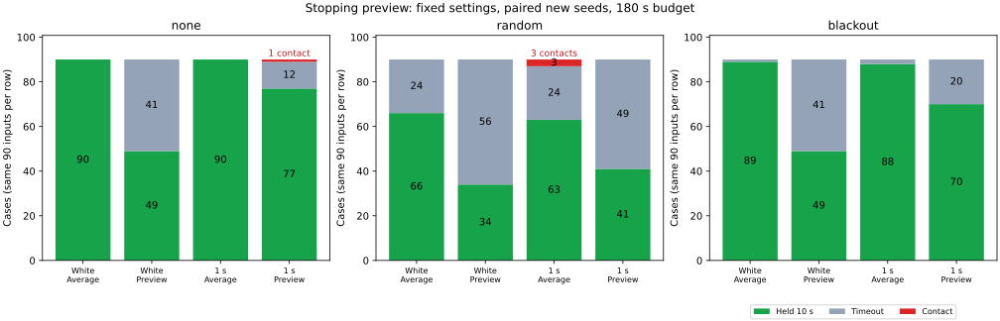

# Stopping preview reduces some contacts but degrades the policy

The fixed-steering stopping preview is not a reliable overall improvement in
these fixtures. It avoided the known dense-map contact and reduced random-loss
contacts on new seeds, but substantially reduced goal completion and introduced
a contact in a no-loss case that the reference controller completed.
It is retained as an optional comparison, with the original defaults unchanged.



| Cohort | Noise tau | Availability | Policy | Held 10 s | Contact | Timeout |
|---|---:|---|---|---:|---:|---:|
| reference | 1 s | none | averaged | 17/18 | 1 | 0 |
| reference | 1 s | none | guarded | 13/18 | 0 | 5 |
| reference | 1 s | random | averaged | 12/18 | 0 | 6 |
| reference | 1 s | random | guarded | 10/18 | 0 | 8 |
| reference | 1 s | blackout | averaged | 16/18 | 1 | 1 |
| reference | 1 s | blackout | guarded | 12/18 | 0 | 6 |
| white-validation | 0 s | none | averaged | 90/90 | 0 | 0 |
| white-validation | 0 s | none | guarded | 49/90 | 0 | 41 |
| white-validation | 0 s | random | averaged | 66/90 | 0 | 24 |
| white-validation | 0 s | random | guarded | 34/90 | 0 | 56 |
| white-validation | 0 s | blackout | averaged | 89/90 | 0 | 1 |
| white-validation | 0 s | blackout | guarded | 49/90 | 0 | 41 |
| correlated-validation | 1 s | none | averaged | 90/90 | 0 | 0 |
| correlated-validation | 1 s | none | guarded | 77/90 | 1 | 12 |
| correlated-validation | 1 s | random | averaged | 63/90 | 3 | 24 |
| correlated-validation | 1 s | random | guarded | 41/90 | 0 | 49 |
| correlated-validation | 1 s | blackout | averaged | 88/90 | 0 | 2 |
| correlated-validation | 1 s | blackout | guarded | 70/90 | 0 | 20 |

The reference cohort uses previously examined seeds 212–213 (108 cases).
Both validation cohorts use new seeds 221–230 (540 cases each), with independent
noise or AR(1) correlation time 1 s. Maps, nominal noise σ, external correction
schedule, observation loss, goal hold criteria, and 180 s budget are fixed.
Preview settings were frozen before the new-seed runs. No case left the map.

For correlated random loss, contact fell from three to zero while successful
holds fell from 63 to 41. The paired comparison gained one hold and lost 23.
With no loss, successful holds fell from 90 to 77 and a new contact appeared.
For independent noise, no contact occurred in either arm, while holds fell
from 90 to 49 without loss and from 66 to 34 with random loss. The increased
waiting cost and the new contact prevent treating this guard as a robust fix.

## Fixed candidate policy

`averaged` is the preceding recovery controller. `guarded` additionally predicts
the nominal command for 0.2 s, followed by bounded braking until speed ≤0.001,
holding the proposed steering. Forecast updates use the same bicycle model and
0.02 s timestep, up to 4 s. Actual braking in the simulation starts immediately.

The positional margin is `0.5 + 2*sqrt(2)*position_sigma + 0.02*observation_age`.
A forecast clearance lower bound at or below this margin latches a brake.
Near point obstacles use all swept segments; far ones use a conservative triangle
inequality bound. Predicted map boundaries are checked too. The guard holds
its triggering steering while braking, except that the existing loss pause
requires zero steering. A received external correction while either pause is
active resets the path cursor.

Release requires measured speed ≤0.02 and forecast clearance above the current
margin plus 0.05 for 0.5 continuous seconds. The preview on release uses the
nominal command that would apply after release. Original loss-pause and goal
stop logic remain in place. Guard time can overlap loss-pause time; these times
must not be added as separate sources of total delay.

This is a deterministic estimated-pose forecast with a heuristic positional
margin. It does not propagate yaw uncertainty or all future steering changes.
Gaussian errors are unbounded. Paths were planned for nominal radius 0.5; a
larger uncertainty margin can block progress on those paths. The preview is
not a true-state safety certificate.

## New contact: correct forecast geometry, inadequate state margin

With correlation time 1 s, no observation loss, maze / Theta* / seed 227, the
guarded arm contacted the obstacle at (24,25) at 164.18 s. Independently
recomputed swept clearance is 0.499058300 against radius 0.5. The reference
arm had no contact.

- At 160.52 s, the guard released with observation age 0.52 s. True position
  error was 0.361874, exceeding the positional buffer 0.293243 above radius.
- At 163.86 s, it released again with age 3.86 s. Position error was 0.451831,
  exceeding buffer 0.360043. True obstacle clearance was only 0.518041, while
  the estimated preview appeared clear enough to resume.
- At contact, the optimized preview lower bound 0.860686705 matched the
  independently computed estimated-trajectory clearance 0.860686705. It
  triggered braking, but the physical step already reached the obstacle.

The geometry optimization was not the source of this failure. The observed
position error exceeded the assumed buffer, and waiting/restarting changed
the vehicle history enough to produce a new failure. A freshness gate alone
would not explain away the first release, which occurred shortly after a fix.
The diagnosis uses true pose offline; true position/error is not used by the
candidate policy. See [guarded-contact-window.csv](guarded-contact-window.csv).

## Validation and reproduction

All 1,188 reference and validation cases passed the trajectory verifier,
including noise recurrence/pairing, pause/release evidence, bounded braking,
frozen steering, physical motion, and unchanged true hold criteria. The
independent geometry audit checked 4,235 deterministic preview checkpoints
(390 reference, 1,939 independent validation, 1,906 correlated validation),
including the new contact endpoint. It recalculated exact geometry without
the simulator's margin-based pruning. All six contact rows across the cohorts
were independently recomputed from the physical swept segments.

The 54 reference rows without the new guard match the preceding correlated
experiment exactly. The old independent-noise runner also passed its 54-case
seed-201 snapshot regression. Formatting, control-crate Clippy for all targets
with warnings denied, and all three headless Pure Pursuit tests passed. The
broader workspace suite was not rerun for this example-only comparison.

From the repository root:

```bash
python3 experiments/pose_observation_loss/run.py --stopping-preview-comparison \
  --noise-correlation-time 1 --seeds 212 213
python3 experiments/pose_observation_loss/run.py --stopping-preview-comparison \
  --noise-correlation-time 1 --seeds 221 222 223 224 225 226 227 228 229 230
python3 experiments/pose_observation_loss/run.py --stopping-preview-comparison \
  --seeds 221 222 223 224 225 226 227 228 229 230
python3 experiments/pose_observation_loss/summarize_stopping_preview.py \
  --reference REFERENCE_RUN --white WHITE_RUN --correlated CORRELATED_RUN \
  --output NEW_ANALYSIS_DIRECTORY --plot
```

The optional `--plot` requires matplotlib; simulation, CSV analysis, and audits
use the Python standard library. Individual case summaries, paired outcomes,
guard events, geometry audits, contacts, and source/input hashes are preserved
beside this report. Raw trajectories are regenerated rather than committed.
The tested checkout was based on `ddc8f0e3f355b7dee550f0e75b4547e3d2c43ac0`
with the example changes present; `sources.json` records that dirty state and
the tested simulator hash. These fixed-map simulation results do not establish
hardware reliability.
