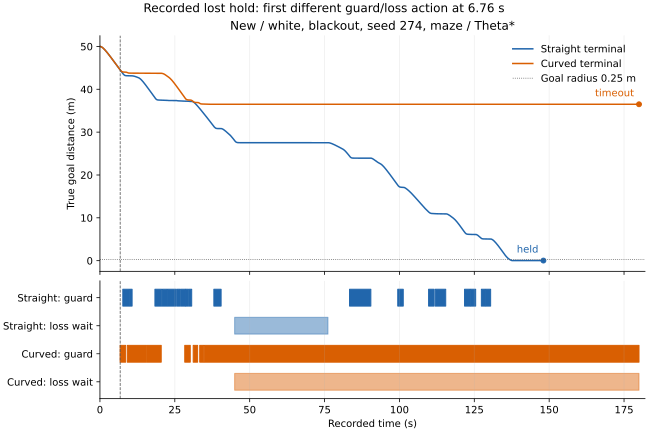

# 曲線予測で保持が変わったのは、最初のどの判断からか

保持を失った6組の最初の分岐は、すべて曲線側の先行停止でした。真の姿勢で計算しても両経路が固定余裕に届かず、曲線側の停止はその余裕を守る判定と整合していました。早い解除による保持喪失という説明は、この最初の分岐には当てはまりません。

ただし、余裕を守る最初の停止だけでは最終保持を説明できません。保持を獲得した6組でも5組は曲線側が先に停止していました。喪失した3組は終盤に欠測待機とガード待機が重なり、停止予測条件を除いた記録上の集計でも、他の復帰条件が1秒続きませんでした。

これは[前回の648ケース](../terminal-arc-live/report.md)の診断です。新しい走行は行っておらず、保持140→140、接触・境界逸脱0という成績と既定値は維持しています。

## 指令が変わった全211組を調べる

[事前条件](protocol.md)を`b62edcd`で固定し、全324組を[accounting.csv](accounting.csv)に残しました。指令が変わった211組の内訳は、両方時間切れ177、両方保持22、保持喪失6、保持獲得6です。残る113組は指令差がなく、結果と終了時刻も同じでした。

最初の停止・解除動作が違う時点までの124,122判断で、直前の物理状態、観測・フィルタ位置、予測姿勢、予定速度・操舵、余裕と現在位置での欠測復帰入力を照合しました。同じ履歴からの最初の差は次のとおりです。

| 群 | 組 | 直線が先に停止 | 曲線が先に停止 | 直線が先に単独解除 | 曲線が先に単独解除 |
|---|---:|---:|---:|---:|---:|
| 既知・独立 | 54 | 9 | 36 | 9 | 0 |
| 既知・相関1秒 | 54 | 29 | 16 | 0 | 9 |
| 新規・独立 | 53 | 7 | 33 | 1 | 12 |
| 新規・相関1秒 | 50 | 13 | 18 | 10 | 9 |
| 合計 | 211 | 58 | 103 | 20 | 30 |

最初の差が欠測復帰だった組は0です。全211組で、最初の動作差とその決め手の時点には補正期間の位置融合を使えず、元の移動補償フィルタ位置へ戻っていました。この分岐を位置融合の精度差には帰属させていません。

50組の単独解除には、それぞれ0.5秒の連続確認がありました。うち31組は解除した行の幾何判定が既に同じで、以前の判定によるタイマー差が残っていました。最後に同じ値だったタイマーと、先行側の連続確認中に後行側が最後に失敗した判定を区別して記録しています。最初の動作差から指令差まで最大40.06秒、指令差から物理状態差まで最大35.40秒あり、三つの時刻を同一視していません。

## 同じ姿勢・同じ操舵で両経路の真の余裕を見る

2,729の方式・時刻の地点を、記録姿勢、真位置＋記録の向き、真姿勢の3通り、直線・曲線の2経路で評価しました。[geometry.csv](geometry.csv)は16,374行です。速度・予定操舵・予定速度と余裕は固定しました。停止開始の余裕は`min(S,T-.1)-entry_margin`、解除は`min(S,T-.05)-release_margin`で、正なら通過です。

共有履歴内の地点は最初の局所比較に使います。分岐後の地点では、その行の姿勢と指令を固定した診断であり、別の制御でその地点へ到達する予測ではありません。

停止の分岐では「停止を避けた側」、解除の分岐では「先に解除した側」を、幾何条件の許可側と呼びます。各組の最後の決め手で、許可側と遮断側の真姿勢による判定を比較しました。

| 許可側の経路 | 組 | 真でも両方通過 | 真では許可側だけ通過 | 真では両方遮断 | 真では遮断側だけ通過 |
|---|---:|---:|---:|---:|---:|
| 直線 | 123 | 37 | 14 | 72 | 0 |
| 曲線 | 88 | 49 | 6 | 33 | 0 |
| 合計 | 211 | 86 | 20 | 105 | 0 |

真でも両方通過した86組では、遮断側が余分に止めていました。両方遮断の105組では、許可側が固定余裕を過大評価していました。その内訳は終端部分のみの不足98組、停止部分と終端部分の不足7組です。真位置に置き換えても向きを記録値にすると、許可側の分類が21組、遮断側が14組で変わりました。二つの数は重なり得ます。

固定余裕の不足と接触は区別します。許可側の真姿勢による予測経路で、中心距離が半径0.5m以下になるものは0、最小は0.631977mでした。真姿勢は評価だけに使用し、操舵や制御には入れていません。この表は指令差のある組に条件づけた異なる幾何経路の比較で、推定器の一般的な精度や独立な211試行の成功率とは扱いません。

## 保持が変わった12組の最初の判断

すべてmazeです。余裕は最初の停止開始判定で、真姿勢によるm単位の値を示します。正なら通過します。「既」は既知seed、「新」は新seed、「白」は独立ノイズ、「相」は相関時間1秒です。

| 群・欠測・seed・計画器 | 保持の変化 | 先に停止 | 時刻（秒） | 真余裕・直線 | 真余裕・曲線 |
|---|---|---|---:|---:|---:|
| 既白・none・269・Theta* | 喪失 | 曲線 | 6.46 | -0.0543 | -0.0935 |
| 既白・random・270・Theta* | 喪失 | 曲線 | 9.54 | -0.1054 | -0.1226 |
| 既相・blackout・270・Theta* | 喪失 | 曲線 | 22.94 | -0.3097 | -0.3468 |
| 既相・random・269・A* | 喪失 | 曲線 | 39.50 | -0.0525 | -0.0630 |
| 新白・none・274・Theta* | 喪失 | 曲線 | 6.76 | -0.0887 | -0.1309 |
| 新白・blackout・274・Theta* | 喪失 | 曲線 | 6.76 | -0.0887 | -0.1309 |
| 既相・blackout・270・A* | 獲得 | 曲線 | 8.34 | +0.0324 | -0.0177 |
| 既相・random・271・Theta* | 獲得 | 曲線 | 48.66 | +0.0094 | -0.0102 |
| 新白・none・274・A* | 獲得 | 曲線 | 7.66 | +0.0759 | +0.0703 |
| 新相・none・276・JPS | 獲得 | 直線 | 7.84 | +0.1896 | +0.2714 |
| 新相・random・274・A* | 獲得 | 曲線 | 9.14 | +0.3900 | +0.2852 |
| 新相・random・276・A* | 獲得 | 曲線 | 8.42 | -0.0511 | -0.1620 |

喪失6組では、直線側は推定上通過していましたが、真姿勢では両方が固定余裕に不足していました。獲得6組は、真では両方通過3、直線のみ通過2、両方遮断1に分かれています。最初に余裕を守って止まったことだけで、その後の到達・保持の増減は説明できません。

## 分岐後の移動と終盤の復帰条件

最初の動作の直前から同じ30秒間の移動距離と待機を比べました。終了距離だけは各方式自身の終了時点です。数値は直線→曲線の順です。5秒窓と、共通終点で切った窓も[windows.csv](windows.csv)に保存しました。

| 組 | 30秒間の移動（m） | 30秒間の待機（秒） | 終了時の目標距離（m） |
|---|---:|---:|---:|
| 既白・none・269・Theta* | 7.780→7.896 | 21.62→20.74 | 0.089→5.687 |
| 既白・random・270・Theta* | 11.170→10.943 | 14.74→15.48 | 0.034→23.429 |
| 既相・blackout・270・Theta* | 22.072→0.543 | 7.94→29.98 | 0.089→30.759 |
| 既相・random・269・A* | 9.173→1.254 | 18.26→26.16 | 0.036→22.090 |
| 新白・none・274・Theta* | 12.429→8.101 | 14.18→19.54 | 0.059→22.183 |
| 新白・blackout・274・Theta* | 12.429→8.101 | 14.18→19.54 | 0.025→36.504 |
| 既相・blackout・270・A* | 13.096→13.514 | 16.38→14.78 | 10.937→0.077 |
| 既相・random・271・Theta* | 7.680→7.661 | 19.84→19.82 | 0.055→0.029 |
| 新白・none・274・A* | 13.325→13.372 | 15.16→12.48 | 10.664→0.056 |
| 新相・none・276・JPS | 1.570→9.001 | 26.48→19.12 | 43.541→0.045 |
| 新相・random・274・A* | 11.966→12.221 | 17.92→17.20 | 4.822→0.118 |
| 新相・random・276・A* | 23.126→24.904 | 5.52→3.68 | 5.156→0.034 |

既白none・269は曲線側の最初30秒の移動が少し多くても、最終的には保持を失いました。既相random・271・Theta*の基準側は170.76秒に初めて目標域へ入り、最初の時点を0.02秒分数えても残り9.26秒で、10秒保持には不足します。曲線側は133.46秒に入り、144.74秒に保持を完了しました。最初の局所判定と、後続の進行・到着時刻は分けて見る必要があります。

喪失6組の曲線側は終盤にも目標域へ入っていません。自身の最後30秒で3組は記録上の移動が0mで、ガード・欠測待機が30秒続きました。残る3組の移動は2.514m、9.586m、1.804mでした。解析した曲線側の時間切れ183組全体では、134組が終盤の移動0.1m未満、49組がそれ以上です。

移動0mだった喪失3組で、欠測復帰を評価した終盤30秒の条件を示します。条件の不成立は重なります。

| 組 | 元の復帰直線の不成立（秒） | 正の予定速度の不成立（秒） | 終端予測の不成立（秒） | 最長連続成立（秒） | 停止予測条件を除いた最長（秒） |
|---|---:|---:|---:|---:|---:|
| 既白・random・270・Theta* | 25.22 | 14.16 | 26.76 | 0.04 | 0.14 |
| 既相・blackout・270・Theta* | 26.80 | 2.48 | 21.00 | 0.38 | 0.38 |
| 新白・blackout・274・Theta* | 26.60 | 18.60 | 27.72 | 0.02 | 0.24 |

必要な連続確認は1秒です。記録を固定して停止予測条件だけを除いても、他の条件がその長さを満たしません。これは条件を外した制御の走行予測ではありません。単独解除と欠測復帰の別、各方式自身の終点と共通終点の別も、[tails.csv](tails.csv)と[requirements.csv](requirements.csv)へ残しています。

## 記録上の一例



前回報告した新seedの喪失で終了距離の増加が最大だった1組を、事前に固定して表示しました。全組を代表する例ではありません。最初の差は6.76秒の曲線側の停止です。その判断直前の6.74秒から5秒間は、直線側が1.598m移動・2.96秒待機、曲線側が0.784m移動・4.44秒待機でした。曲線側は34.86秒以降ガード待機が続き、44.98秒以降は欠測待機も重なります。直線側は148.08秒に保持し、曲線側は目標から36.504mの位置で時間切れでした。

上段は0.2秒間隔に状態変化時点と終点を加えた真の目標距離、下段は全0.02秒判断から作った待機区間です。6.76秒の局所判定だけを、最終状態に対する単独の因果効果とは扱っていません。

## 検証と再実行

解析コードは`e467ff9`です。前回の表・実行情報・シミュレーター・補助関数と、消費した全生軌跡のハッシュを照合しました。以前に全量検証した422軌跡・3,622,492移動区間と同じバイトを再利用し、今回の幾何・履歴・窓集計を追加しています。最初の指令差の時刻は前回の全211組で一致しました。

全16,374幾何行について、同じ入力を再利用するキャッシュを含め、独立した120線分の照合14,382件で両経路を確認しました。最大差は4.49e-6mで弓高上限＋1e-9内です。全地点・両ゲートで2e-8以内の曖昧な分類は0でした。

Python 152テストが成功しました。追加11テストは方式名の対応、先行停止と許可側の反転、両方向の先行解除、0.5秒・1秒確認、現在の幾何が同じでも残るタイマー差、予測位置の同一性、共有終点での窓の打切り、真姿勢への置換と物理半径の区別、窓の開始前イベントを数えないことなどを確認します。Rustコード・制御条件の変更はありません。

```bash
python3 experiments/pose_observation_loss/analyze_terminal_arc_divergence.py \
  --output /tmp/terminal-arc-divergence
python3 experiments/pose_observation_loss/plot_terminal_arc_divergence.py \
  --diagnosis /tmp/terminal-arc-divergence --output /tmp/terminal-arc-example
python3 -m unittest discover -s experiments/pose_observation_loss -p 'test_*.py'
```

出力先は新しいディレクトリにします。両スクリプトは`--raw-root DIR`で、同じ生軌跡を持つ4群の場所を変更できます。7つのCSVと`sources.json`を再集計し、バイト単位で一致しました。図の数値・全待機区間・SVG・実行情報も再生成で一致し、表示を確認しました。

[forks.csv](forks.csv)に最初の分岐と真姿勢による判定、[summary.csv](summary.csv)に群・結果別の集計、[sources.json](sources.json)に入力・コード・生軌跡の指紋、[lost-hold-sources.json](lost-hold-sources.json)に図の指紋を保存しました。
