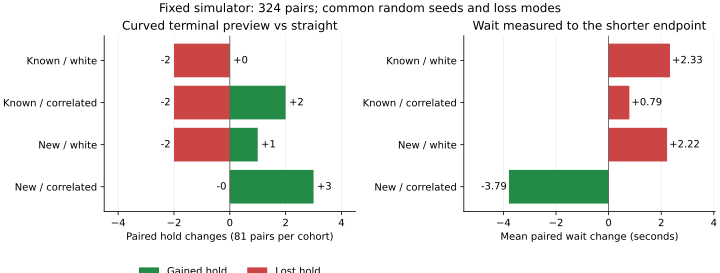

# 操舵を使う終端予測を実際の走行で比較する

終端60cmの直線を予定操舵角の曲線に替えても、全体の保持数は140/324→140/324でした。保持を獲得した6組と失った6組があり、新seedでは70→72、既知seedでは70→68です。前回保持を失った3組は、今回も保持へ届きませんでした。条件によって増減が分かれるため、既定値は無効のままにしています。

これは[直線と曲線の地点比較](../terminal-steering-preview/report.md)に続く新しい走行実験です。地点上の余裕の変化を、そのまま保持の回復と扱わず、変更後の制御で最後まで走らせました。

## 同じ入力で変えるのは終端の経路だけ

[事前条件](protocol.md)を`2d876d5`で固定しました。既知seedは269～271とし、前回保持が変わった4組をすべて含めました。新seedは前回のepoch-previewの走行比較に含まれない274～276です。それぞれ独立ノイズと相関時間1秒のノイズ、欠測なし・random・blackout、3地図×3経路計画器を使い、4群×81組＝324組、両方式648軌跡を比較しました。

基準の`epoch`と候補の`curved`は、停止予測に3補正期間の位置融合と同じ平滑化された向きを使います。融合が使えない間の元フィルタへの復帰も共通です。`curved`だけが、予測停止点から先60cmを、その行の予定操舵角を保つ曲線に替えます。角度の探索や真姿勢による制御は行いません。

停止までの予測、開始・解除の余裕、速度制限、現在位置からの欠測復帰用の直線、0.5秒・1秒の確認タイマー、経路とノイズ・欠測生成器は共通です。末尾の任意CLIフラグ`TERMINAL_STEERING_PREVIEW`は既定でfalseです。変更は実験用exampleと実行・検証スクリプトで、ライブラリの制御器は変更していません。

## 相関ノイズ群の増加と、独立ノイズ群の減少

| 群 | 組 | 基準の保持 | 曲線の保持 | 獲得 | 喪失 |
|---|---:|---:|---:|---:|---:|
| 既知・独立 | 81 | 29 | 27 | 0 | 2 |
| 既知・相関1秒 | 81 | 41 | 41 | 2 | 2 |
| 新規・独立 | 81 | 29 | 28 | 1 | 2 |
| 新規・相関1秒 | 81 | 41 | 44 | 3 | 0 |
| 合計 | 324 | 140 | 140 | 6 | 6 |

| 欠測条件（全群） | 組 | 基準の保持 | 曲線の保持 |
|---|---:|---:|---:|
| なし | 108 | 50 | 50 |
| random | 108 | 43 | 44 |
| blackout | 108 | 47 | 46 |

保持が変わった12組はすべてmazeです。A*では4獲得・1喪失、JPSは1獲得・0喪失、Theta*は1獲得・5喪失でした。同じseed・経路・欠測条件を共有する組があり、これらを独立な反復試験としての有意差や一般的な優劣には置き換えていません。新seedの増加も、この固定シミュレーター内での結果です。



待機はガードと欠測待機の和集合で数え、同じ組の短い終了時刻までを比べました。曲線側から基準側を引いた平均差は次のとおりです。正なら曲線側の待機が増えています。

| 群 | 共通時刻までの平均待機差（秒） | 短い再停止・基準→曲線 |
|---|---:|---:|
| 既知・独立 | +2.334 | 208→329 |
| 既知・相関1秒 | +0.790 | 162→167 |
| 新規・独立 | +2.224 | 310→275 |
| 新規・相関1秒 | -3.790 | 222→237 |
| 全体 | +0.389 | 902→1,008 |

短い再停止は、正の速度指令を伴う解除後1秒以内・移動0.1m未満で、間に欠測待機を挟まず再び停止する既存の集計です。各方式自身の終了までの平均待機は105.368秒→105.658秒、終了時の平均目標距離は27.705m→28.041mでした。両方で保持した134組の完了時刻差は平均+0.521秒です。指令が変わったのは211/324組で、新seed相関群の改善を全体の待機解消や保持増加へ一般化できる結果ではありません。

## 前回保持が変わった4組を追う

すべてmaze/Theta*です。下表の「以前」はaligned→epochでの変化で、今回はepoch→curvedを比較しています。距離は各方式自身の終了時点での真の目標距離、時刻は秒です。

| 群・欠測・seed | 以前の変化 | 基準→曲線の結果 | 基準の終了時刻 | 曲線の終了時刻 | 目標距離・基準→曲線 |
|---|---|---|---:|---:|---:|
| 既知独立・blackout・270 | 保持喪失 | 時間切れ→時間切れ | 180.00 | 180.00 | 11.168→5.492 |
| 既知独立・none・271 | 保持喪失 | 時間切れ→時間切れ | 180.00 | 180.00 | 6.157→10.832 |
| 既知独立・blackout・271 | 保持喪失 | 時間切れ→時間切れ | 180.00 | 180.00 | 9.297→5.463 |
| 既知相関・random・269 | 保持獲得 | 保持→保持 | 161.24 | 163.80 | 0.098→0.085 |

3組の時間切れのうち2組では終了時の距離が縮み、1組では広がりました。保持を獲得した組は今回も保持し、完了は2.56秒遅くなりました。

今回新たに保持を失った組には、既知独立・random・270・maze/Theta*の終了距離0.034m→23.429m、新規独立・blackout・274・maze/Theta*の0.025m→36.504mがあります。単に解除しやすくなれば保持が回復するという関係にはなっていません。保持が変わらない組も含め、全324組を[pairs.csv](pairs.csv)、両方式の全648ケースを[cases.csv](cases.csv)に残しました。

## 検証と再実行

走行の実装は`129b88c`、検証呼び出しの修正は`e24f0aa`です。初回の検証で余分な引数が見つかったため、その呼び出しを直して、保存済みの同じ走行記録を全群で検証し直しました。シミュレーターのコードと生軌跡は変更していません。走行時の実行情報は元のコミットとクリーンな状態を保持しています。

Rust 42テスト（ライブラリ23＋example 19）、Clippyの警告ゼロ、locked release build、Python 141テストが成功しました。今回のRust追加テストは曲線内部の壁最接近、距離が増減する障害物、ほぼゼロの操舵、独立した線分積分との一致、左右反転と停止部分の不変性を確認します。

全648軌跡の4,833,622移動区間を独立に検査し、Euler更新・半径0.5mの区間接触・境界判定を照合しました。両方式の接触・境界逸脱は0、時間切れはそれぞれ184です。最初の異なる指令までの733,061判断で、直前の物理状態・観測と予定指令が共通であることも確認しました。

候補の6,288地点で、停止予測・終端距離・開始/解除判定・速度探索・欠測復帰用の直線を再構成しました。曲線は全地点で独立した120線分の計算と弓高上限によって照合しています。全量のフィルタ再構成は両方式の4,833,622判断に対して行いました。

既知群の無効時162ケースは、過去のepochの全81列・1,231,788行と一致し、各結果CSVもバイト単位で一致しました。新しいフラグを省略した追加9ケースも、明示falseの82列・64,602行と結果CSVがそのまま一致しています。

4つのCSVと`sources.json`を全量監査ごと2回生成し、バイト単位で一致しました。図の数値・SVG・実行情報も再生成で一致し、表示を確認しました。ここでの接触ゼロは固定したモデルとケースでの測定で、推定に基づく距離余裕を将来の走行全体の保証に置き換えていません。

再実行する4群のコマンドは[README](../../README.md#live-comparison-of-straight-and-curved-terminal-previews)にあります。走行後は次のコマンドで全量監査・省略時の回帰確認・図の再生成を行います。

```bash
python3 experiments/pose_observation_loss/analyze_terminal_arc_live.py \
  --raw-root /workspace/scratch/terminal-arc-live --output /tmp/terminal-arc-summary
python3 experiments/pose_observation_loss/check_terminal_arc_default.py \
  --raw-root /workspace/scratch/terminal-arc-live --output /tmp/terminal-arc-default
python3 experiments/pose_observation_loss/plot_terminal_arc_live.py \
  --results /tmp/terminal-arc-summary --output /tmp/terminal-arc-figure
```

出力先は新しいディレクトリにします。全量監査は今回と前回の生軌跡を必要とし、過去の参照先は固定した前回の`sources.json`から使います。このクラウド環境では両方を保存しています。集計と回帰確認はPython標準ライブラリ、図にはMatplotlibを使います。

[summary.csv](summary.csv)に群別・欠測別の結果、[verification.csv](verification.csv)に検証件数、[sources.json](sources.json)に入力・生軌跡・コードの指紋、[default-disabled.json](default-disabled.json)に省略時の一致結果を保存しました。図の数値と指紋は[paired-changes.csv](paired-changes.csv)、[paired-changes-sources.json](paired-changes-sources.json)にあります。
