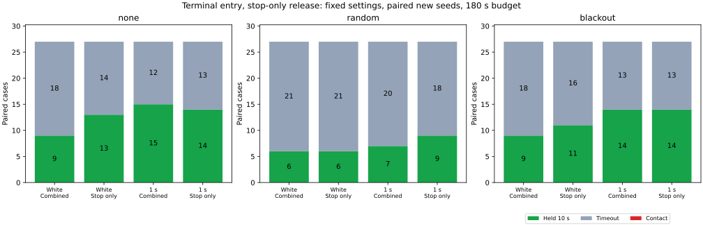

# 開始条件を保ち、解除だけを元に戻す比較

終端の復帰直線を開始判定に残し、解除判定だけを停止軌道に戻すと、新規シードの10秒保持は60/162→67/162、平均待機は111.26→104.45秒でした。しかし短い再発動は197→8,597回に増えました。接触は両群0件です。解除時点で開始条件がすでに不成立の例が多く、次の0.02秒で再発動する挙動を確認したため、この候補は比較用オプションとして残し、既定には採用しません。

## 変更と固定した条件

[前回の診断](../preview-gates/report.md)では、単独解除の判定時間の76.57%が追加直線だけで止まっていました。今回は、[実行前に固定した条件](protocol.md)で、開始判定を共通にして解除判定だけを変えました。元の平滑化群 `filtered` との直接比較ではありません。

`m = 0.5 + 2√2×sigma + 0.02×観測年齢`、停止軌道の距離を `Dstop`、予測停止点から前方0.6の直線の距離を `Dterminal` とします。

| 項目 | 基準 `recoverable` | 候補 `entryline` |
|---|---|---|
| 開始条件を通過 | `Dstop > m` かつ `Dterminal > m + 0.1` | 同じ |
| 解除の距離条件を通過 | `Dstop > m + 0.05` かつ `Dterminal > m + 0.15` | `Dstop > m + 0.05` |
| 単独解除の連続確認 | 静止条件と距離条件を0.5秒 | 同じ |
| 欠落からの同時復帰 | 元の復帰条件と距離条件を1秒 | 同じ |

同時復帰には、実測の静止平均姿勢からの復帰直線、境界、観測数、観測年齢、正の予定指令も引き続き必要です。独立した解除タイマーと同時復帰タイマーの両方で終端条件を外しており、この2つの解除経路の効果までは分離していません。

新しい `TERMINAL_ENTRY_ONLY` は既定で無効で、`RECOVERY_PREVIEW=true` を要します。開始用の `preview_clearance_lower_bound` は変えず、解除用の `release_preview_clearance_lower_bound` を分けました。速度上限、平滑化、操舵、制動、ノイズの余裕、車体半径0.5、180秒の制限、10秒保持は共通です。再発動を防ぐための追加ラッチや閾値は加えていません。真姿勢は判定に使いません。

## 保持と接触

各行81組です。既知シード259〜261は前回の診断で使用済み、新規シードは262〜264です。3地図×3計画器×欠落3条件を、独立・相関1秒のノイズで比較しました。

| 対象・ノイズ | 基準の保持 | 候補の保持 | 保持の獲得 | 保持の喪失 | 接触（基準→候補） |
|---|---:|---:|---:|---:|---:|
| 既知・独立 | 28 | 30 | 3 | 1 | 0→0 |
| 既知・相関 | 40 | 41 | 3 | 2 | 0→0 |
| 新規・独立 | 24 | 30 | 6 | 0 | 0→0 |
| 新規・相関 | 36 | 37 | 2 | 1 | 0→0 |

新規162組では保持の獲得8件・喪失1件、既知162組では獲得6件・喪失3件でした。全648走行で地図外への退出はなく、保持以外はすべて180秒の時間切れでした。

新規・独立ではnoneが9→13/27、randomが6→6/27、blackoutが9→11/27でした。新規・相関ではnoneが15→14/27、randomが7→9/27、blackoutが14→14/27でした。同じ3地図と少数シードの組合せであり、独立な統計標本として改善率を一般化できません。

## 待機と再発動

待機は、欠落待機またはガードの指令区間の和集合です。重なりは1回だけ数え、目標停止だけの区間は加えません。静止中の待機は、判断前の速度の絶対値0.02以下に限定します。

| 対象・ノイズ | 平均待機（基準→候補） | 静止中の平均待機（基準→候補） | 短い再発動（基準→候補） |
|---|---:|---:|---:|
| 既知・独立 | 118.33→111.32秒 | 114.02→104.60秒 | 89→3,728 |
| 既知・相関 | 100.46→97.01秒 | 95.99→92.06秒 | 148→4,452 |
| 新規・独立 | 120.19→110.72秒 | 116.35→104.93秒 | 77→4,859 |
| 新規・相関 | 102.33→98.17秒 | 98.17→93.61秒 | 120→3,738 |

新規全体では平均待機111.26→104.45秒、静止中の平均待機107.26→99.27秒でした。末尾30秒の移動0.1未満の時間切れは84→75例でした。一方、ガード開始は558→10,897回に増え、候補の10,886回は追加直線だけによる開始でした。

短い再発動は、解除指令の速度が正、途中に欠落待機がなく、1秒以内かつ移動0.1未満で次のガードが始まる区間です。新規197→8,597回、既知237→8,180回でした。解除と再発動を多く繰り返しても、待機時間は二重には数えていません。走行は保持完了時または180秒などで終わるため、これらは同一時間窓の率ではありません。

## 解除と開始の条件が食い違う地点

再発動の増加を確認した後、候補の全ガード解除を対象にイベントの内訳を追加診断しました。制御条件やシードの変更は行っていません。

| 対象 | ガード解除 | 解除時点で開始条件が不成立 | 次の0.02秒で再発動 | 不成立のまま解除し、次の0.02秒で再発動 |
|---|---:|---:|---:|---:|
| 既知162例 | 10,323 | 9,238 | 9,258 | 9,178 |
| 新規162例 | 10,812 | 9,834 | 9,889 | 9,792 |

ここでは速度ゼロの解除も含め、欠落による中断を除外していません。「短い再発動」と分母・条件が異なります。候補の予定速度ゼロでの解除は既知1,755回、新規1,895回ありました。

解除が停止軌道だけを確認する一方、次の開始は終端直線も確認するため、同じ判定時点で解除条件を満たしながら開始条件を満たさないことが可能です。新規ではその9,834回中9,792回が次の行で再発動していました。開始条件を外した場合や、両条件を整合させる別の制御の成績は、今回の比較からは分かりません。

## 検証と再実行

- 全648走行と元の既定条件seed201・54走行を検証しました。5走行のシミュレータハッシュは同じで、既知シードの基準群162件は前回の結果と全項目が一致しました。既定54件も保存結果と一致し、元のbaseline・blackoutの接触1件も同じでした。
- 両距離の使い分け、全ガード遷移、両解除タイマー、観測フィルタ、物理応答、対にした乱数、目標保持を照合しました。両群は最初に解除動作が異なるまで、モード・解除距離の2列と証拠時間の2列を除いて一致しました。
- 候補の全開始・解除・欠落復帰と固定地点の計44,496地点で、停止軌道、終端直線、速度用の弧、実際の復帰直線の幾何を独立に再計算しました。候補の欠落からの全復帰469回を含みます。追加イベント診断の解除数も全軌跡の解除数と一致しました。
- Pythonの49テスト、Rust exampleの7テスト、Pure Pursuitのライブラリ3テストが通過しました。Headless Releaseビルド、`std`を有効にした全ターゲットのClippy（警告をエラー扱い）、Rust/Python整形・構文チェックも通過しました。旧72列形式の9軌跡でも元の解除判定へのフォールバックを確認しました。
- 集計を再実行し、6つのCSVと実行情報のバイト単位の一致を確認しました。

[READMEの手順](../../README.md#compare-terminal-entry-with-stop-only-release)で再実行できます。[all-results.csv](all-results.csv)、[summary.csv](summary.csv)、[paired-holds.csv](paired-holds.csv)、[control-events.csv](control-events.csv)、[preview-audit.csv](preview-audit.csv)、[release-entry-gaps.csv](release-entry-gaps.csv)と[sources.json](sources.json)を保存しました。図にはMatplotlibを使います。生軌跡は再実行で生成します。

シミュレータSHA-256は `e1bae117d1a1c5fe2db9cdcffec1eef5c57105f66d3ca97617bbec8d41656e22` です。正確な測定速度・適用操舵・車体モデルに依存する姿勢補償や、相関誤差・共通バイアスへの制約は前回と同じです。今回確認できたのは、解除だけを元に戻すと一部の保持と待機が改善する一方、開始条件との食い違いによって再発動を大量に増やすことです。
