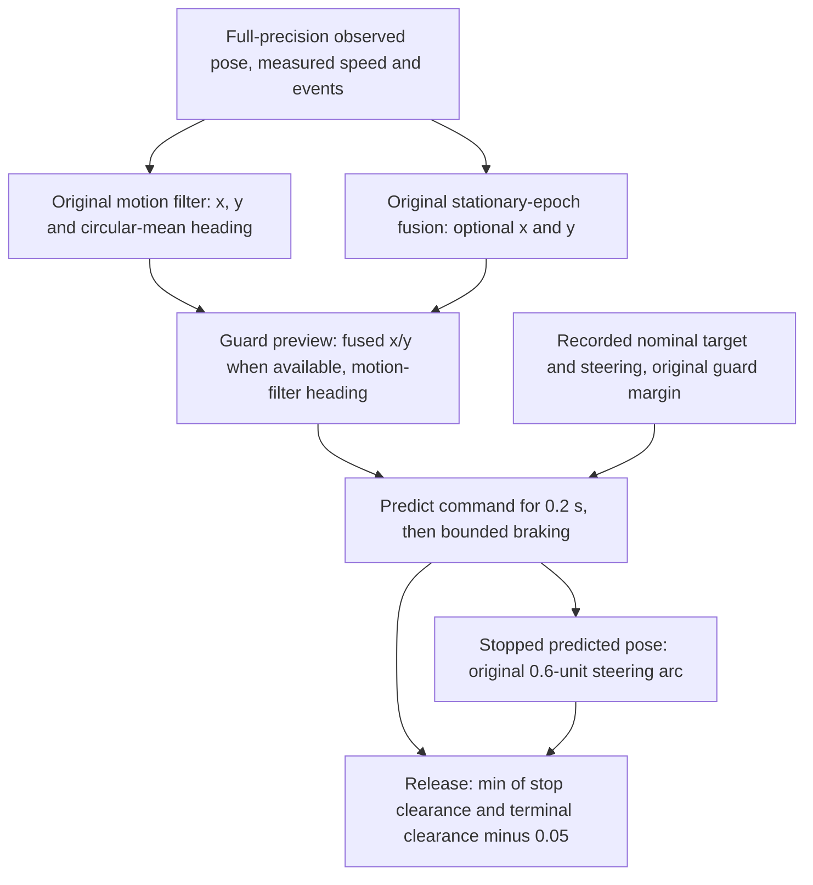

# Exact terminal-preview history and fixed input comparisons

The original terminal preview is reproducible from sensor observations alone.
All 394,494 mean-arm decisions reproduce the logged estimator state, and all
11,998 selected recorded queries reproduce the stopping, terminal and combined
clearances at their original nine-decimal precision.

At those selected decisions, the guard-preview heading already agrees with
the recovery-window heading to floating-point precision. Replacing only the
initial position changes release in both directions: 849 failures become
passes, while 1,027 passes become failures. All 2,722 original ready controls
retain a passing release comparison. A zero-target diagnostic changes 555
release failures into passes; it does not resolve the remaining 5,693 failures.

These are static queries on the same seed1001 packet. They are not new vehicle
trajectories, continuous-timer results or recovery-rate improvements. The
previous mean-arm 24 held / 30 timeout outcomes are unchanged observations.

## Frozen population and implementation

The [protocol](protocol.md) and [85 frozen input hashes](freeze-pins.json) were
committed at `92da4a5` from main
`b8136fce0b6ef0577d82c9218025d0281a301657`. This includes the complete previous
geometric-witness study, reused scripts, original simulator/vehicle sources,
fixtures, manifests and lockfile. Known prior gate outcomes are listed in the
protocol; new estimator histories and alternative results were not extracted
until implementation `2a0cedc4e8c745cf1e93b8dad7774bb0b99f2765` was committed.
That implementation had already passed all 1,372 tests without skips.

All 54 mean-arm cases remain. All 394,494 decisions from the six mean-arm
trials replay in their original order, including 18 cases with no selected
decisions. Selection is exactly `used=true && nominal_target>0`, retaining all
11,998 selected decisions and all 2,722 ready controls. The 47,992 static
queries are four calculations per selected decision, not independent trials.

## What the original preview actually receives



The recovery window supplies a current-epoch mean. The motion filter supplies
heading, while stationary-epoch fusion can replace preview x/y with a
three-epoch position. The nominal steering was computed from the original
observed pose and remains fixed in every comparison here.

The native reader uses the original Rust `MotionPoseFilter`,
`StationaryEpochFusion`, `mean_pose`, observation event types and vehicle update.
It feeds full-precision observed pose, measured speed, previous applied steering,
correction/precision events and observation age from the sidecar. It uses the
original `step * DT` clock and resets all history at each case boundary.
Physical truth and rounded preview poses never enter either estimator.

Every decision must exactly reproduce the logged nine-decimal motion-filter
x/y and final preview x/y/yaw, motion-filter sample count, fusion availability
and fusion group count. Precision epochs and original ordered margin formulas
are reconstructed; the full-precision speed margin must match the sidecar
exactly. The supported fixed configuration has consistency filtering disabled,
motion filtering and epoch fusion enabled, and both guard-buffer options
disabled. Other configurations are rejected. [history-checks.csv](history-checks.csv)
retains all 54 case coverage checks.

The unchanged `stopping_preview`, `terminal_arc_clearance` and
`aligned_release_preview` compute each result. The original stopping-motion
prefix also exports the stopped pose, step count and traveled length; that
pose must reproduce the original terminal result exactly. The recorded query
must match all three original formatted clearances and the release margin.
Its full-precision strict release result must agree with the previous rounding
interval classification. Current recovery-line comparisons use their closed
rounding intervals and the exact margin, with no unresolved cases. All
previous per-case masks and selected counts match exactly.

## Four fixed static queries

| Variant | Initial position | Initial heading | Proposed target |
| --- | --- | --- | --- |
| recorded | Original reconstructed preview | Original preview | Recorded positive nominal target |
| mean_position | Recovery-window mean x/y | Original preview | Same positive target |
| mean_pose | Recovery-window mean x/y | Recovery-window mean | Same positive target |
| zero_target | Original reconstructed preview | Original preview | Zero |

Measured speed, steering, margins and map are held fixed. `mean_position`
versus `recorded` isolates initial position; `mean_pose` versus `mean_position`
isolates heading; `zero_target` versus `recorded` isolates proposed target.
These conditional comparisons are not additive causal attribution.
The zero-target query retains measured speed, so it does not force instantaneous
rest. It is a diagnostic and is not a positive-command admission candidate.

| Variant | Release passes | Release failures | Fail to pass versus recorded | Pass to fail versus recorded | Stop failures |
| --- | ---: | ---: | ---: | ---: | ---: |
| recorded | 5,750 | 6,248 | 0 | 0 | 74 |
| mean_position | 5,572 | 6,426 | 849 | 1,027 | 0 |
| mean_pose | 5,572 | 6,426 | 849 | 1,027 | 0 |
| zero_target | 6,305 | 5,693 | 555 | 0 | 74 |

The largest position replacement is 0.286329 model units. The largest absolute
preview-versus-recovery heading difference is approximately
`1.272222e-14` degrees (`2.220446e-16` radians). Replacing heading after position
produces zero additional release flips in either direction. This result concerns
the filtered terminal-preview heading; the speed probe's raw heading is a
different input, as documented in the previous study.

## Preserve the other failed gates and the controls

| Original failure mask | Decisions | Recorded release passes | Mean-position passes | Mean-pose passes | Zero-target passes |
| --- | ---: | ---: | ---: | ---: | ---: |
| None: ready control | 2,722 | 2,722 | 2,722 | 2,722 | 2,722 |
| Recovery clearance | 3,028 | 3,028 | 2,001 | 2,001 | 3,028 |
| Recovery clearance and release | 6,095 | 0 | 698 | 698 | 535 |
| Release | 153 | 0 | 151 | 151 | 20 |

Of the 849 position-query release improvements, 698 still have the original
recovery-line failure. The other 151 come from the 153 release-only decisions.
All 1,027 new release failures occur in decisions already failing recovery
clearance. All original ready controls keep passing release. These overlaps
matter when interpreting the net decline of 178 release passes; neither a net
count nor the favorable flips alone describes the joint gates.

The zero-target diagnostic changes 555 of the 6,248 original release failures,
with no reverse flips. Of these, 535 still fail the original recovery line and
20 come from release-only decisions. The remaining 5,693 release failures all
include insufficient terminal clearance; 74 also fail stop clearance. Removing
the proposed target therefore does not explain away most recorded failures.

[case-summary.csv](case-summary.csv) has all 54 cases for all four variants,
including zero-selected cases. [summary.csv](summary.csv) has all 192
noise/mode/original-mask/variant cells, including empty cells, and both
directions of paired flips against the original query and the specified parent
query. Case and decision denominators remain separate. Decisions are dependent
within trajectories and this is one seed.

## Fixed examples and compact evidence

The following are the previous study's three fixed plot IDs, retained without
choosing new examples based on these outcomes:

| ID / original mask | Original stopping travel | Original terminal-release gap | Zero-target gap |
| --- | ---: | ---: | ---: |
| 51 / clearance | 0.024882 | +0.004580 | +0.019911 |
| 52 / clearance;release | 0.024882 | -0.006406 | +0.011312 |
| 1597 / release | 0.024882 | -0.000422 | +0.021481 |

Gap is `terminal_clearance - 0.05 - release_margin`, using the original ordered
arithmetic. The position and heading replacements are identical to the original
pose at these three examples, so only the proposed-target diagnostic changes
their results. Zero-target coordinates stay unchanged at native precision;
the retained measured speeds are tiny but nonzero (approximately `5.42e-18`,
`4.99e-18` and `3.11e-19`). They illustrate a stopping-prefix effect, while the complete population
also contains the position effects tabulated above.

[representatives.csv](representatives.csv) preserves the previous exact 132 IDs
and first/minimum-recovery-gap roles, including controls. Every ID retains all
four variants in [representative-comparisons.csv](representative-comparisons.csv)
and [representative-native.csv](representative-native.csv). Full static inputs
are in `representative-inputs.tsv`. The compact population does not replace
the complete case and mask summaries.

## Reproduction and verification

With Python 3.12, the activated Rust compiler, a clean committed checkout,
the complete frozen pilot packet and fresh external output paths:

```bash
python3 -B experiments/pose_observation_loss/analyze_terminal_preview.py \
  --raw /path/to/mean-speed-probe-raw --output /tmp/terminal-inputs-1
python3 -B experiments/pose_observation_loss/analyze_terminal_preview.py \
  --raw /path/to/mean-speed-probe-raw --output /tmp/terminal-inputs-2
```

[sources.json](sources.json) binds the implementation, scripts, frozen inputs,
raw manifest and compact outputs. [native-sources.json](native-sources.json)
binds the full sensor history, metadata, native source/binary, trace and all
classified decisions. Exact reference provenance records implementation
`2a0cedc`; later HEADs record their own commit. Two repeats at the same clean
HEAD must match each other.

[repeat-verification.json](repeat-verification.json) records byte equality of
all 19 collector files from two fresh runs, including history, source, binary,
full traces, tables and provenance. [representative-verification.json](representative-verification.json)
records a separate recompilation of the archived source and direct replay of
all 528 compact inputs; the complete native output matches byte for byte.
For direct replay, compile `terminal-preview.rs` and invoke the binary as
`native-terminal-preview direct OBSTACLES INPUTS CHECKS exact-original-functions`,
redirecting stdout to the native CSV. `INPUTS` is the compact TSV; `CHECKS` is
a fresh auxiliary output path.

[validation.json](validation.json) records all 1,372 tests passing with zero
errors, failures or skips, including 16 new history, geometry, paired-selection,
corruption and output-protection tests. Full run packets remain outside Git
under `/workspace/scratch/terminal-preview-input-replay/aggregate-1` and
`aggregate-2`; the raw packet remains under
`/workspace/scratch/mean-speed-probe-live-pilot/raw`. Completion provenance is
written only after all reconstruction and coverage checks pass.

The original controller, margins, steering selection, timers, noise, raw
observations and historical endpoints retain their frozen bytes. This study
isolates static input differences; evaluating a live policy's continuous
admission and resulting trajectories requires a separate comparison.
